<div align="center">



<br/><br/>

<a href="https://t.me/chanel441"></a>

</div>

<br/>

### `$ whoami`

DevOps engineer. I build and run cloud infrastructure: **AWS + Kubernetes**, all of it in **Terraform**,
shipped through **GitOps** and watched by **Prometheus**.

I came in from systems programming and automation (C, Python, Linux, network tooling) and still treat
infrastructure the same way: explicit, measurable, no magic.

<br/>

### `$ ls ~/work`

<table>
<tr>
<td width="50%" valign="top"><b>Infrastructure as code</b><br/><sub>Multi-account AWS described end to end in Terraform. Reusable modules, remote state in S3 with DynamoDB locking, hand-made resources imported instead of left to rot.</sub></td>
<td width="50%" valign="top"><b>Kubernetes platform</b><br/><sub>EKS clusters with Karpenter and HPA, honest requests and limits, PodDisruptionBudgets, readiness and liveness probes that actually mean something.</sub></td>
</tr>
<tr>
<td width="50%" valign="top"><b>Delivery</b><br/><sub>GitLab CI and Jenkins shared libraries, cached builds and parallel jobs. Deploys go through ArgoCD: git is the source of truth, rollback is one click.</sub></td>
<td width="50%" valign="top"><b>Observability</b><br/><sub>Prometheus, Grafana, Loki, Alertmanager. SLOs for the critical paths and burn-rate alerts, so incidents page a human before users notice.</sub></td>
</tr>
<tr>
<td width="50%" valign="top"><b>Security</b><br/><sub>IRSA and least-privilege IAM, External Secrets with AWS Secrets Manager, Trivy in CI, Kyverno policies at admission.</sub></td>
<td width="50%" valign="top"><b>Cost and reliability</b><br/><sub>Spot capacity through Karpenter, rightsizing, S3 lifecycle rules, non-prod asleep at night. Multi-AZ, postmortems, fewer 3 a.m. surprises.</sub></td>
</tr>
</table>

<br/>

### `$ cat stack.yaml`

<table>
<tr>
<td><code>cloud · infra</code></td>
<td></td>
</tr>
<tr>
<td><code>ci/cd · gitops</code></td>
<td><br/>
<code>ArgoCD</code> <code>Helm</code> <code>Karpenter</code></td>
</tr>
<tr>
<td><code>observability</code></td>
<td><br/>
<code>Loki</code> <code>Alertmanager</code> <code>VictoriaMetrics</code> <code>ELK</code> <code>Zabbix</code></td>
</tr>
<tr>
<td><code>security</code></td>
<td><code>IRSA</code> <code>IAM</code> <code>External Secrets</code> <code>Secrets Manager</code> <code>Trivy</code> <code>Kyverno</code></td>
</tr>
<tr>
<td><code>code · systems</code></td>
<td><br/>
<code>systemd</code> <code>TCP/IP</code> <code>DNS</code></td>
</tr>
<tr>
<td><code>data</code></td>
<td><br/>
<code>RDS</code> <code>ElastiCache</code> <code>DynamoDB</code></td>
</tr>
</table>

<br/>

### `$ cat principles.txt`

```text
everything as code   →  if it is not in git, it does not exist
measure first        →  dashboards before opinions
boring in prod       →  clever stuff lives in side projects
explicit over magic  →  know what runs, where, and why
```

<br/>

### `$ ls ~/side-quests`

- **C utilities** with explicit memory and execution control
- **Python automation**: Telegram bots, scrapers, monitoring with alerts
- **Arduino** tinkering with timing-sensitive logic
- **Daily driver**: CachyOS + Hyprland, tuned down to the compositor

<br/>

<div align="center">
<sub><code>44@platform:~$ exit</code></sub>
</div>
